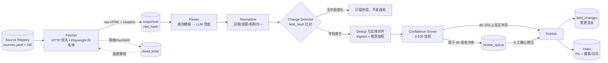

# College-AM 自动化更新检索：数据管道设计与技术选型

> 本文回答一个问题：**在不依赖人工逐条录入的前提下，如何让 100~300 条考试/竞赛信息保持"可信、可追溯、可回滚"。**
> 结论先行：**静态优先、规则优先、diff 驱动发布、人审卡在发布前**。全量 LLM 抽取和全量浏览器渲染都是错误默认值——前者贵且不稳定，后者慢且容易被风控。

---

## 0. 摘要：三条硬约束决定了整个架构

在动工前，我先对 5 个真实站点做了探测，结果直接推翻了"写个爬虫抓一下"的想当然：

| 站点 | 实测特征 | 对架构的含义 |
|---|---|---|
| cet.neea.edu.cn | 首页 20 KB 纯静态 HTML，无 SPA 根节点；列表页为 `ul#first_data > li`，标题在 `a[title]`，日期在 `span#ReportIDIssueTime`；`robots.txt` 返回 404（无显式限制） | **规则模板可直接命中，零渲染成本** |
| dasai.lanqiao.cn | 首页仅 **1 437 字节**，HTML 里只有一个 `<div id="root">` | 必须 JS 渲染，或逆向其 XHR 接口 |
| yz.chsi.com.cn | 89 KB HTML，含 `id="app"` 与 iframe，列表由 XHR 二次拉取 | 优先抓接口，不要无脑上浏览器 |
| rkb.ruankao.org.cn | 请求返回 **HTTP 410** + 阿里云 WAF 拦截页 | 直接判"不可自动抓取"，降级人工 |
| tiaozhanbei.net | `robots.txt` 明确 `Disallow` GPTBot/ClaudeBot/CCBot/PerplexityBot/Bytespider，且 `User-agent: *` 禁止 `/project/`、`/project/list/` | **合规上必须放弃抓项目列表**，只取公开通知页 |

由此得到三条硬约束：① 站点形态高度异质，**不能有单一抓取通道**；② 大多数页面是静态的，**浏览器渲染必须是白名单例外而非常态**；③ 一部分站点从合规或技术上就抓不了，**架构必须能优雅地"放弃并降级"**，而不是让整条链路卡死。

---

## 1. 端到端链路



每一环的契约如下。**关键设计：每一环都是幂等的纯函数，输入输出落库，任何一环都能单独重放**——这是排障速度的决定因素。

| 环节 | 输入 | 输出 | 失败模式 | 重试策略 |
|---|---|---|---|---|
| **Source Registry** | `sources.yaml`（Git 管理） | `sources` 表 + 本次待抓 URL 列表 | YAML 语法错、slug 重复、URL 不可达 | 不重试；CI 阶段 schema 校验直接拒绝合并 |
| **Fetcher** | source_id, url, fetch_mode | 原始响应体 + 状态码 + 响应头 + `raw_hash` | DNS/超时/TLS 错误；403/410 WAF；200 但正文 < 500 字节（空壳） | 指数退避 1m→5m→30m→2h→12h，最多 5 次；**4xx（除 429）不重试**，直接进 DLQ 并降级；同源并发 ≤ 2 |
| **Parser** | 原始响应体 + `parser_key` | `extracted jsonb` + `selector_hit_ratio` | 选择器全落空；字段类型错；编码乱码（GBK 站点） | 规则失败 → 自动切 LLM 兜底 1 次；仍失败 → DLQ + 模板失效告警；**不做同参数盲重试**（页面没变就不会有好结果） |
| **Normalizer** | `extracted jsonb` | 强类型字段（date/numeric/数组） | 日期写成"12月中旬"、金额写成"每人 30 元"、机构名带括号后缀 | 纯函数，无网络；失败即 `unknown` 并记 `normalize_warnings`，**绝不猜值** |
| **Change Detector** | 新 `field_hash` vs 库内最新 | `diff jsonb` 或 `no_change` | 哈希碰撞（可忽略）；时区不一致导致假变更 | 无重试；确定性计算，可随时全量重算 |
| **Dedup** | 新 Program/Edition + 候选集 | `merge` / `new` / `needs_review` | 误合并（把两个比赛合成一个）；漏合并（同赛两条） | 阈值内自动；灰区进队列；**合并可逆**（保留 `merged_into`，不物理删） |
| **Confidence** | 字段完整度、来源层级、解析方式、冲突标记 | 0–100 分 + 分项明细 | 评分规则被绕过；人工修正后分数不刷新 | 无重试；每次字段变更重算，历史分数留档 |
| **Review Queue** | 分数 < 85 或存在冲突的记录 | 人工裁决结果 | 队列堆积；同一条反复进出 | 去重入队（同 entity 同 reason 只留一条）；SLA 超时升级告警 |
| **Publish** | 已批准记录 | `published_at` + `field_changes` + 缓存失效 | 发布半途失败导致缓存与库不一致 | 事务内改库 + 事务后异步失效缓存；失败重放发布事件 |
| **Index** | 已发布记录 | 搜索索引、`.ics` 日历源、`schema.org/Event` | 索引滞后；中文别名召回不到 | 幂等 upsert；每日 03:00 全量对账一次 |

**一条铁律**：Fetcher 与 Parser 之间**必须**落 `snapshots`。所有"上周明明还是对的"这类争议，都靠原始快照复盘——不存快照的抓取系统，等于没有证据链。

### 1.1 置信度打分（决定"自动发布"还是"进队列"）

分数不是感觉，是五项加权求和，每次字段变更重算，明细落 `review_queue.diff`：

```
confidence = 40 × tier_score        -- L1=1.0, L2=0.85, L3=0.6, L4=0.3
           + 25 × completeness      -- 必填 8 字段中非 null 的占比
           + 20 × parse_quality     -- rule=1.0, llm_with_evidence=0.8, llm=0.5
           + 10 × cross_source      -- 第二源一致=1.0, 仅单源=0.5, 有冲突=0
           +  5 × freshness         -- 30 天内抓取=1.0，每超 30 天减 0.2
```

判定：**≥ 85 自动发布；70~84 进队列（可批量通过）；< 70 必须逐条人工**。注意 `cross_source` 项的设计——**单源最高只能拿 40+25+20+5+5=95**，但涉及报名截止日与费用时，单源一律强制进队列，不参与自动发布。这条规则挡住的是最贵的一类错误：某站转载时把"4 月 10 日"写成了"4 月 1 日"。

---

## 2. 抓取层选型

| 方案 | 渲染能力 | 120 源规模的适配度 | 单页成本 | 致命问题 |
|---|---|---|---|---|
| **Scrapy** | 无（需 scrapy-playwright 插件） | 吞吐过剩，但引入 Python 第二技术栈 | ≈0 | 与 TS 主站割裂，1 人维护两套依赖 |
| **Crawlee（CheerioCrawler）** | 无（PlaywrightCrawler 另开） | **最佳**：同 TS 栈、自带队列/重试/指纹、并发控制现成 | ≈0 | 生态与文档弱于 Scrapy |
| **Playwright** | 完整 | 只该用于 10%~15% 的 SPA 白名单 | 0.3~0.8 元/千页（CPU 时间） | 全量使用会让 2C4G 机器直接打满，且更容易触发风控 |
| **RSS / 官方 API** | 不需要 | 有就优先，成本最低、最稳 | ≈0 | 国内政务站几乎不提供 |
| **Firecrawl** | 完整 | 可作兜底 | Standard 套餐 $83/月含 10 万 credits：满额摊销 0.006 元/页，但按我们 1 万页/月只能摊到 **0.06 元/页**（订阅费是固定门槛）；超出 $5/1000 credits ≈ 0.036 元/页 | 数据出境、延迟 2~8 秒、无法定制中文站 UA 与限速 |
| **Jina Reader** | 中等（转 Markdown） | 只适合"读一篇文章"，不适合列表页增量 | 按 token 计费 | 无列表结构，拿不到"有哪些新公告" |
| **DeepSeek Fetch API** | 中等 | 同上，适合正文理解 | 5 元 / 1000 次成功请求 | 不解决列表发现与反爬 |

**建议**：主干用 **Crawlee 3.x + Cheerio**（纯 HTTP），白名单 SPA 用 **Playwright 1.65**，第三方 API 只作**故障期的应急取证通道**（当某站突然改版、模板全失效时，用它一次性抓回基线，再人工写新模板）。

理由不是性能——按 1 万页/月算，平均每小时才 14 页，**吞吐根本不是瓶颈**。真正的瓶颈是"1~3 个人能不能长期维护"。选型标准因此是：**与主站同语言、单进程可跑、依赖少**。Scrapy 更快，但为一个用不满 1% 的性能引入 Python 技术栈，是负收益。

**抓取礼仪（写进代码，不靠自觉）**：默认 0.2 QPS（5 秒 1 次/源）、遵守 `Crawl-delay`（赛氪明确要求 10 秒）、固定 UA 并在其中带项目主页、只在 `robots_ok=true` 时启用自动抓取。**顺序上先读 `robots.txt` 再决定是否入库**，而不是先抓后补。

---

## 3. 解析策略：规则为主，LLM 兜底

分两层，且**必须能回答"这条数据是谁抽的"**。

**L1 规则模板**（覆盖 80%+ 站点）。每个源一个 YAML，随代码走 Git，可 review：

```yaml
# sources/cet-neea.yaml
slug: cet-neea
tier: L1
fetch_mode: static
rate_limit_qps: 0.2
entry: https://cet.neea.edu.cn/html1/category/16093/1124-1.htm
list:
  container: "ul#first_data > li"
  fields:
    title:   "span#ReportIDname > a::attr(title)"
    url:     "span#ReportIDname > a::attr(href)"
    pubdate: "span#ReportIDIssueTime::text"
  url_base: "https://cet.neea.edu.cn"
  max_items: 20
detail:
  content_selector: "#Content1"     # 仅取纯文本做 content_hash，不存全文
guards:
  min_items: 3                      # 少于 3 条即判定模板失效
  expect_date_format: "%Y-%m-%d"
```

`guards.min_items` 是整个设计里最便宜也最有效的保护：**页面改版的第一症状永远是"列表条数变成 0 或 1"**，而不是报错。

**L2 LLM 兜底**。触发条件只有三个：① 新源冷启动（还没有模板）；② 规则抽取的关键字段缺失率 > 40%；③ `selector_hit_ratio` 连续 3 次低于 0.6。调用时强制 JSON 输出，并在 prompt 里写死三条禁令：

1. **原文没有的字段一律输出 `null`，禁止推断**（"预计 3 月报名"不是日期）；
2. 日期必须回抄原文片段到 `evidence` 字段，便于人工核对；
3. 输出必须通过 JSON Schema 校验，否则视为失败。

**抽取结果 Schema**（存 `snapshots.extracted`，也是对外数据仓的字段契约）：

```json
{
  "$schema": "https://json-schema.org/draft/2020-12/schema",
  "title": "ProgramEditionExtract",
  "type": "object",
  "required": ["schema_version", "name", "source_url", "fetched_at", "trust_tier"],
  "properties": {
    "schema_version": { "const": "1.0" },
    "name":           { "type": "string", "minLength": 4, "maxLength": 120 },
    "aliases":        { "type": "array", "items": { "type": "string" }, "maxItems": 8 },
    "organizer":      { "type": ["string", "null"], "maxLength": 60 },
    "kind":           { "enum": ["cert", "contest", "job", "other"] },
    "year":           { "type": ["integer", "null"], "minimum": 2000, "maximum": 2100 },
    "round":          { "type": "string", "default": "main" },
    "signup_start":   { "type": ["string", "null"], "format": "date" },
    "signup_end":     { "type": ["string", "null"], "format": "date" },
    "event_start":    { "type": ["string", "null"], "format": "date" },
    "event_end":      { "type": ["string", "null"], "format": "date" },
    "fee_cny":        { "type": ["number", "null"], "minimum": 0, "maximum": 5000 },
    "fee_note":       { "type": ["string", "null"], "maxLength": 80 },
    "official_url":   { "type": ["string", "null"], "format": "uri" },
    "majors":         { "type": "array", "items": { "type": "string" } },
    "trust_tier":     { "enum": ["L1", "L2", "L3", "L4"] },
    "source_url":     { "type": "string", "format": "uri" },
    "fetched_at":     { "type": "string", "format": "date-time" },
    "parse_method":   { "enum": ["rule", "llm", "manual"] },
    "evidence":       { "type": "object", "additionalProperties": { "type": "string" } }
  },
  "additionalProperties": false
}
```

字段语义有三条容易被忽略但必须写死的规则：**① 时间字段允许 `null`，但 UI 必须显示"未公布"，不许留空**；**② `fee_cny` 是数值，"免费"必须存 `0` 并把原文写进 `fee_note`，"待定"必须存 `null`**；**③ `trust_tier` 来自 Source，不允许模型自己判断**——这是防止模型把野鸡站吹成 L1 的唯一办法。

---

## 4. 增量与变更检测

三级哈希，职责分离：

| 哈希 | 计算对象 | 用途 |
|---|---|---|
| `raw_hash` | 原始响应体（gzip 解压后） | 判断"这次抓取有没有拿到新东西"，去重存储 |
| `content_hash` | 正文容器纯文本，去空白/去导航 | 判断"正文有没有变"，用于改版检测与审计 |
| `field_hash` | 归一化后结构化字段的**排序 JSON** 的 sha256 | **唯一触发下游发布的信号** |

**核心规则：只有 `field_hash` 变化才发布。** 页面加了一条页脚备案号、换了个 banner，`raw_hash` 变、`content_hash` 可能变，但 `field_hash` 不变 → 只落快照，不发通知、不刷新详情页时间戳。这一条能把日常噪声压掉 90% 以上，也是"用户不会一周收到 8 条假更新"的根本原因。

字段级 diff 存 `field_changes`：

```json
{
  "edition_id": 1042,
  "snapshot_id": 88213,
  "changed_at": "2026-11-24T03:12:07+08:00",
  "changes": [
    { "field": "signup_end", "old": "2026-04-10", "new": "2026-04-15",
      "reason": "官方延期公告", "confidence_delta": 3 }
  ],
  "publish": "immediate"
}
```

前端只渲染"报名截止由 4/10 延至 4/15"这样的变化徽标，而不是整页重刷。

**模板失效告警**（比 diff 更重要）。每次抓取记录三个指标，任一越界即告警：

1. `selector_hit_ratio` = 命中字段数 / 期望字段数，连续 3 次 < 0.6；
2. `item_count` < `guards.min_items`（列表从 20 条掉到 1 条，基本就是改版了）；
3. `byte_size` 相对该源 30 天中位数偏移 > 60%（改版常伴随体积突变）。

```sql
-- 每周跑一次，找出正在腐化的模板
SELECT s.slug,
       round(avg(sn.selector_hit_ratio)::numeric, 3) AS hit_ratio,
       count(*) FILTER (WHERE sn.selector_hit_ratio < 0.6) AS bad_runs,
       max(sn.fetched_at) AS last_run
FROM snapshots sn
JOIN sources s ON s.id = sn.source_id
WHERE sn.fetched_at > now() - interval '7 days'
GROUP BY s.slug
HAVING count(*) FILTER (WHERE sn.selector_hit_ratio < 0.6) >= 3
ORDER BY bad_runs DESC;
```

告警走"分级降噪"：单次失败不响，**同一源连续 3 次失败或连续 2 天命中率异常才发企业微信/邮件**，否则运维会被噪声淹没而开始无视告警。

---

## 5. 去重与实体对齐

分两级，别混为一谈：**Edition 级是精确去重**（同一来源的同一 URL 只留一条），**Program 级才是模糊匹配**（同一个比赛被 3 个站转载）。

归一化三步：

1. **机构归一**：剥离"（原×××）""办公室""委员会"等后缀；建立 `organizer_alias` 表，把"教育部教育考试院"与"教育部考试中心"标为同一实体。
2. **名称归一**：去书名号/引号、全角转半角、繁转简、剔除"第 X 届""2026 年""关于举办…的通知"等噪声片段，得到 `name_norm`。
3. **年份与届次抽取**：从标题与正文抽 `year`、`round`，作为对齐的强约束——**跨年份不必合并**，是自然的 Edition 边界。

打分公式（每项归一到 0~1）：

`score = 0.50 × sim(name_norm) + 0.30 × org_match + 0.20 × year_match`

其中 `sim()` 用 PostgreSQL `pg_trgm` 的 `similarity()`，`org_match` 取 1.0 / 0.6（别名命中）/ 0（不同）。判定阈值：

- **≥ 0.86**：自动合并为同一 Program，只新增 Edition；
- **0.72 ~ 0.86**：进 `review_queue`（reason=`new_program`），人工 5 秒裁决；
- **< 0.72**：新建 Program。

阈值不是拍脑袋：0.86 在中文赛事名上约等于"只差届次/主办方后缀"，0.72 以下常出现"全国大学生数学建模竞赛"与"全国大学生数学竞赛"这类真不同但字面相近的情况——**宁可多问一次，不可错并一条**。

```sql
-- 候选召回：走 GIN trgm 索引，1000 条规模下 < 10ms
SELECT p.id, p.name, p.organizer,
       round(similarity(p.name_norm, $1)::numeric, 3) AS name_sim
FROM programs p
WHERE p.status = 'active'
  AND p.name_norm % $1                 -- % 走 pg_trgm 索引
ORDER BY name_sim DESC
LIMIT 10;
```

**冲突不自动覆盖**：当两个 L1 源对 `signup_end` 给出不同值时，不取"更新的那个"，而是标记 `field_conflict` 进队列——因为"更新"不等于"更对"，可能只是转载了同一份错误通知。

---

## 6. 调度与运维

**频率分层**（写进 `sources.cron_expr`，但实际调度由加权器动态调整）：

| 层级 | 对象 | 基础频率 |
|---|---|---|
| T0 | 正在报名窗口内的核心源（CET、软考、蓝桥杯、数模） | 每日 1 次（03:00–06:00 随机抖动，避免整点齐发） |
| T1 | 报名期前 21~30 天 / 结束后 7 天内的源 | 每 3 日 |
| T2 | 常规源 | 每周 1 次 |
| T3 | 归档页、历史公告 | 每月 1 次 |

**考试季加权**：用 `program_editions` 里已知的 `signup_start` 反推——`signup_start` 前 21 天起到 `signup_end` 后 3 天止，该源自动升到 T0。这样不需要人工记"三月和九月要勤抓"，**数据自己会说要加频**。

**监控四指标**：抓取成功率（目标 > 95%）、解析空值率（< 15%）、`field_changes` 日增量（突增 3 倍 = 可能模板错位导致全量误判）、P95 端到端延迟（< 90 秒/轮）。

**死信队列**：`dead_letter` 表存 payload + 失败原因 + 尝试次数，提供 `POST /admin/dlq/:id/replay`。超过 5 次仍失败 → 源标记 `degraded`，前端该源条目显示"最近未更新"，同时把该源降级为人工维护清单。

**成本估算（人民币，月）**：

| 项目 | 用量 | 单价 | 月成本 |
|---|---|---|---|
| 抓取请求 | 按 T0/T1/T2/T3 分层（30 源日更、40 源 3 日、40 源周更、10 源月更）× 每源 4 页 ≈ **200 页/日 ≈ 6 000 页/月**；旺季翻倍 + 重试按 **1 万页/月** 估 | 自建 | ≈ 0 |
| 服务器 | 1 台 2C4G（应用 + PG + 抓取同机） | 60~120 元/月 | **80** |
| LLM 抽取 | ≈2 000 次/月（约 20% 页面走兜底与关键字段二次校验）；每次输入 ≈6K tok、输出 ≈0.8K tok → 输入 12M（80% 命中缓存）、输出 1.6M | deepseek-flash 高峰价（保守）：9.6M×0.04 + 2.4M×2 + 1.6M×8 = 0.4+4.8+12.8 | **≈ 18** |
| 备份 / 对象存储 | 20 GB | ≈0.12 元/GB/月 | **3** |
| 域名 + 证书 | — | — | **5** |
| 监控 | Uptime Kuma 自建 | — | 0 |
| **合计** | | | **≈ 110 元/月（预留 40% 缓冲 → 150 元）** |

对照第三方：Firecrawl 最低够用的 Standard 套餐为 **$83/月（≈590 元，按 7.1 汇率）**，含 10 万 credits——摊到 1 万页是 0.06 元/页，但**订阅费是固定门槛，约为自建方案（≈110 元）的 5 倍**；且每页多 2~8 秒延迟、无法定制中文站 UA 与限速、数据出境还额外增加合规审查成本。因此它只在“某站紧急改版、需一次性抓回基线”时按次使用，不作常态通道。**真正的成本是人，不是机器**：这套系统的月度云成本约 110 元，但每周仍需 4~6 小时人力。

---

## 7. 数据模型（PostgreSQL 16）

```sql
CREATE EXTENSION IF NOT EXISTS pg_trgm;

CREATE TYPE program_kind AS ENUM ('cert','contest','job','other');
CREATE TYPE trust_tier   AS ENUM ('L1','L2','L3','L4');
CREATE TYPE fetch_mode   AS ENUM ('static','js','api','rss','manual');
CREATE TYPE review_state AS ENUM ('auto','pending','approved','rejected','stale');

CREATE TABLE sources (
  id                bigserial PRIMARY KEY,
  slug              text NOT NULL UNIQUE,
  name              text NOT NULL,
  entry_url         text NOT NULL,
  tier              trust_tier NOT NULL,
  fetch_mode        fetch_mode NOT NULL DEFAULT 'static',
  parser_key        text,
  cron_expr         text NOT NULL DEFAULT '0 3 * * *',
  rate_limit_qps    numeric(4,2) NOT NULL DEFAULT 0.2,
  robots_ok         boolean NOT NULL DEFAULT false,
  robots_checked_at timestamptz,
  enabled           boolean NOT NULL DEFAULT true,
  health            text NOT NULL DEFAULT 'ok'
                    CHECK (health IN ('ok','degraded','manual')),  -- degraded 自动降级，manual 人工维护
  last_ok_at        timestamptz,
  consecutive_fail  int NOT NULL DEFAULT 0,
  created_at        timestamptz NOT NULL DEFAULT now()
);

CREATE TABLE programs (
  id             bigserial PRIMARY KEY,
  kind           program_kind NOT NULL,
  name           text NOT NULL,
  name_norm      text NOT NULL,
  aliases        text[] NOT NULL DEFAULT '{}',
  organizer      text,
  organizer_norm text,
  official_url   text,
  majors         text[] NOT NULL DEFAULT '{}',
  tags           text[] NOT NULL DEFAULT '{}',
  summary        text CHECK (char_length(summary) <= 80),   -- 与产品文档一致：自撰摘要 ≤80 字
  status         text NOT NULL DEFAULT 'active'
                 CHECK (status IN ('active','merged','archived')),
  merged_into    bigint REFERENCES programs(id),
  created_at     timestamptz NOT NULL DEFAULT now(),
  updated_at     timestamptz NOT NULL DEFAULT now()
);

CREATE TABLE program_editions (
  id                bigserial PRIMARY KEY,
  program_id        bigint NOT NULL REFERENCES programs(id) ON DELETE RESTRICT,
  year              smallint NOT NULL,
  round             text NOT NULL DEFAULT 'main',
  signup_start      date,
  signup_end        date,
  event_start       date,
  event_end         date,
  fee_cny           numeric(10,2) CHECK (fee_cny >= 0),
  fee_note          text,
  venue             text,
  official_url      text,
  primary_source_id bigint REFERENCES sources(id),
  confidence        smallint NOT NULL CHECK (confidence BETWEEN 0 AND 100),
  review_state      review_state NOT NULL DEFAULT 'pending',
  field_hash        text NOT NULL,
  first_seen_at     timestamptz NOT NULL DEFAULT now(),
  last_changed_at   timestamptz NOT NULL DEFAULT now(),
  published_at      timestamptz,
  CONSTRAINT edition_uniq UNIQUE (program_id, year, round),
  CONSTRAINT date_order CHECK (signup_start IS NULL OR signup_end IS NULL
                               OR signup_start <= signup_end)
);

CREATE TABLE snapshots (
  id                 bigserial PRIMARY KEY,
  source_id          bigint NOT NULL REFERENCES sources(id),
  url                text NOT NULL,
  url_hash           text NOT NULL,
  http_status        smallint,
  raw_hash           text NOT NULL,
  content_hash       text,
  byte_size          int,
  fetched_at         timestamptz NOT NULL DEFAULT now(),
  parser_key         text,
  item_count         int,               -- 列表条目数，模板失效的第一信号
  selector_hit_ratio numeric(4,3),
  extracted          jsonb,
  CONSTRAINT snapshot_uniq UNIQUE (source_id, url_hash, raw_hash)
);

CREATE TABLE review_queue (
  id          bigserial PRIMARY KEY,
  entity_type text NOT NULL CHECK (entity_type IN ('program','edition','source')),
  entity_id   bigint,
  snapshot_id bigint REFERENCES snapshots(id),
  reason      text NOT NULL CHECK (reason IN
              ('low_confidence','field_conflict','new_program','schema_invalid','source_layout')),
  priority    smallint NOT NULL DEFAULT 50,
  diff        jsonb,
  status      text NOT NULL DEFAULT 'open'
              CHECK (status IN ('open','in_review','done','skipped')),
  assignee    text,
  created_at  timestamptz NOT NULL DEFAULT now(),
  resolved_at timestamptz,
  resolution  jsonb
);

CREATE TABLE field_changes (
  id          bigserial PRIMARY KEY,
  edition_id  bigint NOT NULL REFERENCES program_editions(id) ON DELETE CASCADE,
  snapshot_id bigint REFERENCES snapshots(id),
  changes     jsonb NOT NULL,
  changed_at  timestamptz NOT NULL DEFAULT now()
);

CREATE TABLE dead_letter (
  id          bigserial PRIMARY KEY,
  source_id   bigint REFERENCES sources(id),
  url         text NOT NULL,
  stage       text NOT NULL CHECK (stage IN ('fetch','parse','normalize')),
  error_kind  text NOT NULL,          -- timeout / waf_block / layout_break / schema_invalid
  error_msg   text,
  attempts    smallint NOT NULL DEFAULT 1,
  payload     jsonb,                  -- 失败时的原始响应头/片段，供复盘
  created_at  timestamptz NOT NULL DEFAULT now(),
  replayed_at timestamptz,
  resolved    boolean NOT NULL DEFAULT false
);

-- 索引设计：每一条都对应一个真实查询
CREATE INDEX programs_name_trgm   ON programs USING gin (name_norm gin_trgm_ops);
CREATE INDEX programs_aliases_gin ON programs USING gin (aliases);
CREATE INDEX editions_window_idx  ON program_editions (signup_end)
      WHERE review_state = 'approved';
CREATE INDEX editions_program_idx ON program_editions (program_id, year DESC);
CREATE INDEX snapshots_time_brin  ON snapshots USING brin (fetched_at);
CREATE INDEX snapshots_lookup_idx ON snapshots (source_id, url_hash, fetched_at DESC);
CREATE INDEX review_open_idx      ON review_queue (priority DESC, created_at)
      WHERE status = 'open';
CREATE INDEX field_changes_ed_idx ON field_changes (edition_id, changed_at DESC);
CREATE INDEX dlq_open_idx         ON dead_letter (created_at DESC)
      WHERE resolved = false;
```

三个说明：**① 上面的 DDL 是可直接执行的单表版；数据量涨到约 500 万行再分区**，且分区不是加个 `PARTITION BY` 就完事——PG 要求分区表的**主键与唯一约束都必须包含分区键**，所以真实做法是 `PRIMARY KEY (id, fetched_at)`，同时 `review_queue.snapshot_id` 降级为**不带外键的普通 bigint**（跨分区无法建 FK），并把 " 每 URL 只留一条 " 的判重限定在最近 2 个分区。这三处改动必须在建表前一次做对，事后迁移代价极高；**② 部分索引里不能写 `CURRENT_DATE`**（非 immutable），"正在报名"的过滤放在查询里而不是索引谓词里；**③ `programs` 不物理删除**，合并只写 `merged_into`，保证外链与历史 URL 不 404。

---

## 8. 人机协同

**必须人工的五类**（其余全自动）：

1. **新源准入**——robots 合法性、站点性质、是否官方，一次性决策；
2. **置信度 < 85 的发布**——尤其涉及**报名截止日与费用**，错一天就是事故；
3. **字段冲突**——两个 L1 源打架时，只有人能判断哪个是转载错误；
4. **下架与纠错申诉**——用户举报"这个比赛取消了"，必须人工核实后置 `stale`；
5. **合并/拆分 Program**——误合并的破坏性远大于漏合并。

**审核界面**（三栏，目标 < 20 秒/条）：

- 左：队列列表，按 `priority DESC, created_at` 排序，显示源名/原因/等待时长，超过 48 小时标红；
- 中：**字段级 diff 高亮**——旧值红、新值绿，右侧嵌原始页面快照（iframe 指向本地存档，不请求源站，避免审核时反被风控）；
- 右：结构化表单 + 三个动作 `通过(A) / 修正(E) / 驳回(R)`，支持 J/K 上下切换。修正后的值**必须回写 `parse_method='manual'`**，否则下次抓取又会被旧模板覆盖。

**工时估算（稳态）**：120 源 / 300 条 Edition，每周新增或变更约 40 条，其中 30% 需人工 ≈ 12 条 × 1.5 分钟 ≈ 20 分钟；每周源维护（改模板、处理告警）约 2 小时；抽查 20 条约 30 分钟；**合计 4~6 小时/周**。旺季（3 月、9 月）翻倍到 8~10 小时。这与产品文档"1 人上限 6~8 小时/周"的结论一致——**超过这个量就必须加人，而不是加自动化**。

---

## 9. 现实风险与缓解

| 风险 | 现实表现（已实测/已知） | 缓解方案 | 止损线 |
|---|---|---|---|
| **WAF / 反爬** | 软考官网直接返回 410 + 阿里云 WAF 页 | 不做对抗；该源转人工维护，仅在报名季由人确认后录入 | 连续 14 天失败 → 自动降级为 manual |
| **验证码** | 政务站报名入口常见滑块/图形码 | **永不触碰报名入口**，只抓公开公告页；遇到即停 | 出现验证码即该 URL 加入黑名单 |
| **页面改版** | 列表条数骤降、选择器全落空 | `min_items` + 命中率监控 + 快照留证；改版后 30 分钟内可定位，2 小时内重写模板 | 单源模板失效 > 7 天 → 前端标注"信息可能滞后" |
| **法律 / 合规** | 挑战杯 robots 明确禁 AI 爬虫且禁 /project/；赛氪要求 Crawl-delay 10 秒 | **只做索引 + 摘要 + 跳转，不转载全文**；尊重 robots；限速；署名来源；提供删除通道 | 收到任何站点书面反对 → 24 小时内下线该源 |
| **数据准确性责任** | 用户按错误截止日错过报名 | 每条展示来源 + 抓取时间 + 可信等级；关键字段双源交叉；错误更正 SLA 24 小时 | 同一字段月度纠错 ≥ 3 次 → 该源降级 |
| **源站消失 / 域名变更** | 考试院机构改革后域名迁移（"考试中心"→"教育考试院"） | 每个 Program 保留 `official_url` 与备用入口；站点 301 自动跟随并记录 | 连续 30 天 404 → 标记 archived 但保留页面 |
| **AI 爬虫封禁扩大** | 越来越多站点在 robots 里点名封 GPTBot/CCBot | UA 如实标识为 `College-AM-Bot`，**不伪装成浏览器**；被封即停 | 同上，转人工 |

最后一条值得单独强调：**不要伪装 UA**。伪装能多抓三个月，但一旦被发现，项目在高校圈的口碑会一次性归零——而这个项目的全部资产就是"可信"。宁可少抓 10 个源，也不要多一个"被拉黑"的把柄。

---

## 10. 落地顺序（M0 四周）

| 周 | 交付 | 验收 |
|---|---|---|
| W1 | `sources.yaml` + `snapshots`/`sources` 表 + Crawlee 抓取骨架 | 10 个源能稳定落快照，成功率 > 90% |
| W2 | 规则模板 + Normalizer + 字段 Schema | 抽检 20 条，字段准确率 > 95% |
| W3 | `field_changes` + 置信度 + `review_queue` + 审核台 | 能完整走通"抓到→判定→人工→发布" |
| W4 | 调度加权 + 告警 + DLQ + 索引与 .ics 输出 | 连续 14 天无人值守跑通，告警误报 < 2 次/周 |

**可行性判断（给决策用）**：技术上**完全可行**，且成本极低（≈110 元/月）；真正的约束有两条，都不在技术侧——① **人审产能**：稳态 4~6 小时/周，超过 300 条 Edition 就必须加人，加自动化解决不了；② **源站态度**：只要有一个 L1 源明确禁止抓取，覆盖度就出现缺口，这只能靠"官方合作 / 人工维护 / 用户纠错"补，不能靠技术绕。因此本方案的定位是**"降低人工录入成本 70%，而不是消灭人工"**——按这个预期立项是合理的，按"全自动无人值守"立项一定会失败。

**一句话总结**：这套架构的复杂度不在抓取，而在**"如何证明一条信息是对的、并且能说清它什么时候变成了错的"**。抓取是最容易的部分——真正决定项目能不能活过一年的，是第 4 节的 diff 纪律、第 8 节的人审卡口，和第 9 节里那条"宁可少抓 10 个源"的克制。
