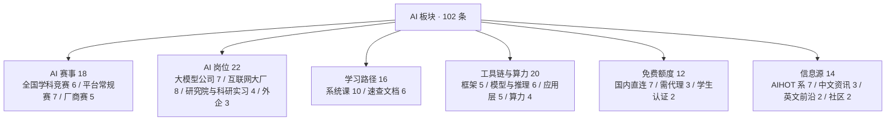

# AI 板块信息架构：102 条入口如何不变成链接垃圾场

> 前置约束：零依赖静态站、`scripts/build.mjs` 生成、无 JS 交互、移动端 390px 优先。
> 一句话结论：**从现在的 25 条扩到 102 条不是问题，"每条只值一个链接"才是问题。** 判断标准只有一条——把这张卡片删掉，用户是不是只少了一个链接？如果是，它就是垃圾。

---

## 0. 结论前置

| 问题 | 结论 |
|---|---|
| 现有 4 组够不够 | **不够，重划成 6 组**；8 个候选里砍 1 个（论文降级）、并 1 个（教程入 learn）、现有 news 并入 feed，理由见 §1.2 |
| 每组多少条 | 18 / 22 / 16 / 20 / 12 / 14 = **102** |
| 卡片加几个字段 | 字段从 5 个到 **12 个**（必填 9），但屏幕上只多 **1 行**（`fit`）+ 1 排徽标 |
| 页内导航 | 目录格 + `h3` 二级分区 + 锚点；**不做多标签筛选**，只做 1 个 CSS 开关 |
| 怎么保住"可核查" | 把核查对象从"事实"换成 **"存活 + 归属"**，并用 CI 强制 `verified` 不过期 |
| 最大风险 | 体积与密度失衡——目标 **< 130 KB**；三个反面教材实测 748 KB / 915 KB / 抽 4 条仅 1 条干净 200 |

---

## 1. 分组结构

### 1.1 最终方案：6 组

| # | id | 中文标题 | 条数 | 一句话职责 | 排序理由 |
|---|---|---|---|---|---|
| 1 | `contest` | AI 赛事 | 18 | 现在能报什么、什么时候截止 | **唯一有"过期就没了"属性的组**，错过成本最高，必须第一 |
| 2 | `job` | AI 岗位 | 22 | 谁在招、什么时候开、去哪看 | 用户点名要扩的组，动机最强（找工作 > 学习） |
| 3 | `learn` | 学习路径 | 16 | 从零到能做出东西，按顺序学什么 | 决定"能不能用上后面所有东西"的前置动作 |
| 4 | `stack` | 工具链与算力 | 20 | 用什么写、在哪跑 | 学的中途马上要用，与 learn 强耦合但不合并 |
| 5 | `free` | 免费额度 | 12 | 不花钱能拿到什么 | 学生的硬约束是钱，紧跟工具链（正好接上"跑不起"的痛点） |
| 6 | `feed` | 信息源 | 14 | 怎么持续跟上，而不是被喂 | 唯一"给入口不给内容"的组，放最后，因为它不是行动项 |

组内再用 `h3` 切二级分区，把单屏可选条目压到 **6–8 个**——这才是控制"垃圾场感"的真正开关，比分组本身更重要：



### 1.2 砍掉哪个候选、降级哪个、并入哪个

任务给的 8 个候选里，**"论文与前沿"和"教程与文档"都不该独立成组**。

**砍「论文与前沿」→ 降级为 `feed` 的二级分区。** 理由不是不重要，是**我们守不住**。arXiv 每天新增数百篇，任何静态站都不可能"聚合前沿"；硬做的结果是三个季度没更新的论文标题，比不放更伤可信度。能核实的是"这个入口存在且活跃"，不能核实的是"今天有什么新论文"——只承诺前者。

**砍「教程与文档」→ 并入 `learn` 的第二分区。** 用户在"我要学"和"我卡住了"之间切换，是同一个心理动作里连续发生的；拆成两个一级组会让导航从 6 个变 7 个，而 100 条时**导航长度是稀缺资源**。

**「免费额度与羊毛」保留，但改名「免费额度」并删掉"羊毛"。** "羊毛"暗示一次性套利，会吸引一批领完就走、还顺手举报额度失效的用户；"免费额度"是学生长期的真实约束。同时这一组必须有最严格的核实日期（见 §4）。

**现存代码里已有的第 4 组「AI 资讯」（7 条，全是 AIHOT 入口）并入 `feed` 信息源，作为它的第一个二级分区。** 理由：`news` 与 `feed` 是同一个心理动作——"我想知道发生了什么"。保留两个组会让用户在每个组里都只看一半，而 AIHOT 那 7 条本身也只是"信息源"的一种（且是唯一需要写`aggregator` 免责声明的一组，见 §4 机制 4 与 `docs/research/08-aihot-integration.md` 的合规结论：只做外链、不转载、不缓存）。合并后 `feed` 的 14 条 = AIHOT 系 7 条 + 中文资讯 3 条 + 英文前沿 2 条 + 社区 2 条。

**由此得到一条可执行的迁移规则：老 4 组 → 新 6 组不是"加两组"，而是"拆 1 组、并 1 组、加 2 组"。** 现状是 4 组 25 条（news 7 / contest 6 / job 6 / learn 6），拆解如下：

| 原组 | 原条数 | 去向 |
|---|---|---|
| `news` | 7 | **整体并入 `feed`**，作为「AIHOT 系」分区 |
| `contest` | 6 | 留在 `contest`，扩到 18 |
| `job` | 6 | 留在 `job`，扩到 22 |
| `learn` | 6 | **一分为二**：3 门课（CS229 / MIT OCW / Coursera）+ 教材 d2l 留在 `learn`；2 个工具（PyTorch 教程 / ModelScope）移入新组 `stack` |

净效果：新增 `stack` 与 `free` 两个组，`learn` 从"课 + 工具混装"变成纯学习路径——**这正是用户说的"缺少深度"的根源**：原 `learn` 把"该按什么顺序学"和"用什么工具跑"混在一栏，读者既看不出路径，也找不到工具。

### 1.3 为什么不按"CV/NLP/多模态/Agent"分

现有 `tags` 已经在做方向标记。**把方向升级成一级分组是错的**：一个做 RAG 的学生同时需要 NLP 的课、Agent 的框架、向量库的工具，按方向切会让他每组都只看三分之一。方向是**筛选维度**，不是**组织维度**——这与 §3 不做多标签筛选是同一个判断。

---

## 2. 每条卡片的字段规范

### 2.1 字段表

| 字段 | 必填 | 类型/长度 | 含义 | 出现在哪 |
|---|---|---|---|---|
| `id` | ✅ | slug | 稳定标识，做锚点 | 不显示 |
| `name` | ✅ | ≤24 字 | 名称 | 卡片标题行 |
| `url` | ✅ | https | 外链 | 整个卡片是 `<a>` |
| `org` | ✅ | ≤16 字 | 主办方/运营方 | 标题行右侧小字 |
| `desc` | ✅ | 10–60 字 | **是什么**（客观陈述） | 卡片第 2 行 |
| `fit` | ✅ | 12–50 字 | **谁该用 / 什么时候别用**（编辑判断） | 卡片第 3 行，左侧竖线强调 |
| `access` | ✅ | direct / vpn / login | 国内能否直连 | 徽标 |
| `verified` | ✅ | YYYY-MM-DD | 最后验证存活日期 | 徽标（灰） |
| `cost` | ✅ | free / freemium / paid | 使用成本 | 徽标 |
| `note` | ⬜ | ≤80 字 | 坑点/注意事项 | `<details>` 折叠，有值才渲染 |
| `tags` | ⬜ | ≤3 个 | CV/NLP/多模态/Agent/推理部署 | 折叠内 |
| `kind` | ⬜ | official / platform / aggregator | 一手 / 平台方 / 第三方整理 | 徽标（仅 aggregator 警示色） |

**必填 9 个、选填 3 个。** 现有卡片是 5 个字段（`name`/`url`/`who`/`desc`/`tags`），其中 `who` 在本文改名为 `org`（语义不变，只是名字更准）。真正新增的只有 4 个：`fit` / `access` / `verified` / `cost`——每一个都对应一个具体问题，没有一个是装饰。

### 2.2 卡片上显示什么（4 层，高度 ≤ 112px）

```
┌──────────────────────────────────────────┐
│ Kaggle Competitions            Google    │  ← name（15px 粗）+ org（12px 灰，右）
│ 全球最大的数据科学竞赛平台，分 Featured / │  ← desc（13.5px，2 行内截断）
│ Research / Playground 三类。              │
│ │ 有 Python 和 pandas 基础再进；纯新手先  │  ← fit（12.5px，左边框 2px accent）
│ │ 去 learn 组把 d2l 前 5 章过完。         │
│ [国内可直连] [2026-11-24 验证] [部分免费] │  ← 徽标排（11.5px）
└──────────────────────────────────────────┘
```

**`fit` 是全案最重要的一行。** 它承担三个功能：区分"值得点"和"点进去浪费时间"、替代做不了的推荐算法、**证明这张卡片有人读过**——一条没写 `fit` 的条目，读者没有理由相信它不是机器批量生成的。

### 2.3 点开显示什么（原生 details，零 JS）

不做 hover——**hover 在移动端不存在**，把关键信息藏在 hover 里等于移动端永远看不到。

用原生 `<details>/<summary>`：纯 HTML、无 JS、键盘可达、屏幕阅读器能读。caniuse 实测（2026-11）**全球 97.4%**，缺口只在 IE 与 Opera Mini 这类可以放弃的浏览器上——这是它能替代 hover 的依据。**只在 `note` 或 `tags` 有值时才渲染**，所以大约 1/3 的卡片有折叠块，页面不会被均匀撑高。

折叠里只放两类信息：`note`（坑点，如"免费层每月 30 小时 GPU，超时自动停"）和 `tags`（方向）。**不放"相关推荐"**——那是推荐算法伪装成静态内容，同一个陷阱。

### 2.4 三条硬校验（写进 `scripts/validate.mjs`，不通过就构建失败）

1. `desc` < 10 字 → 失败。防"XX 平台"这种没信息量的描述。
2. `fit` < 12 字或 > 50 字 → 失败。**下限是反垃圾的核心机制**：12 字写不出"什么人别用"，也就写不出判断。
3. `access=vpn` 占比 > 25% → 警告。一个面向中国大学生的站，四分之一入口打不开是产品事故。

---

## 3. 页内导航

### 3.1 三层结构

**第一层：目录格（hero 下方，6 个格子）。** 每格显示组名 + 条数 + 6 字副标题；移动端 2 列 × 3 行，桌面 3 列 × 2 行。复用现有 `.channels` / `.channel` 样式，零新增 CSS。

**第二层：`h3` 二级分区 + 锚点。** 全站 20 个 `h3`（3+4+2+4+3+4）各带 `id`；每组标题下先给一行"本组 3 节"的节内链接。**这是把赛事组的"一屏 18 条"压到"一屏 6 条"的唯一手段**，比任何筛选器都有效。

**第三层：组间跳转。** 每组底部两个文字链接"← 上一组 / 下一组 →"。100 条页面的真实痛点是"看完想换组还得滚回顶部"，这两个链接成本 40 字节，收益极高。

### 3.2 必须先修的一个现存 bug

现有 `.top` 是 `position: sticky; top: 0; z-index: 20`（`site/assets/style.css:65–69`），内层 `.top .wrap` 高 `56px`（同文件 `:72`），移动端 `560px` 以下改为 `flex-wrap: wrap; height: auto`（`:255–256`）——折行后实际更高，约 90px。而整个样式表**没有任何 `scroll-margin-top`**（已全文检索确认）。所以现在点 `#contest` 锚点，标题会被顶栏盖住；100 条时这个 bug 会从"轻微"变成"导航完全失效"。

两行就能修：

```css
section[id] { scroll-margin-top: 72px; }
@media (max-width: 560px) { section[id] { scroll-margin-top: 100px; } }
```

### 3.3 做 1 个 CSS 开关，不做多标签筛选

**结论：只做「隐藏需代理的条目」这一个开关，用 checkbox hack；多标签筛选不做。**

为什么只做这一个：`access=vpn` 是**唯一"点了也白点"的属性**——学生在校园网点开 ChatGPT 只会看到超时，这是纯粹的时间损失。按它过滤是刚需，不是偏好。

为什么不做多标签筛选，三条都是移动端的硬理由：

- **点击目标不够**。390px 下 5 个方向标签做成 chips，每个约 56×28px，低于 44×44px 的可点击下限，误触率高于成功率。
- **状态不持久**。checkbox 状态在页面跳转后丢失，用户从"赛事"跳到"岗位"再回来，筛选没了，得重点一次。
- **没有"清除"心智**。多选 checkbox 没有天然的"全部重置"入口，用户会卡在"我到底筛了什么"。

实现（无 JS，DOM 顺序保证可用）：

```html
<input type="checkbox" id="hide-vpn" class="ai-toggle-input">
<label for="hide-vpn" class="ai-toggle">隐藏需代理的条目</label>
<!-- 各 section 与 input 同级，且在其之后，~ 选择器才生效 -->
<section id="contest"> ... <li class="ai-item" data-access="vpn"> ... </li> ... </section>
```

```css
.ai-toggle-input { position: absolute; opacity: 0; pointer-events: none; }
#hide-vpn:checked ~ section .ai-item[data-access="vpn"] { display: none; }
```

**已知瑕疵，接受它**：如果某个 `h3` 下的条目全是 vpn，会剩下一个空标题。用 `:has()` 可以修（`section:not(:has(.ai-item:not([data-access="vpn"])))`），但查 caniuse（2026-11 数据）后这个方案要否掉——**全球支持率 96.09%，缺口恰好在中国**：QQ 浏览器 14.9 不支持、百度浏览器 13.52 不支持、UC 15.5 不支持。这三个正是国内学生手机上最常见的壳浏览器。为一个装饰性瑕疵去赌主力用户群的渲染结果，不划算——**空一行比白屏好**。

---

## 4. 与"可核查"人设的一致性

### 4.1 问题说清楚

主站的可信度来自一个闭环：**这条日期 → 点回官方原文 → 原文里确实写着这个日期**。AI 板块没有这个闭环——外链背后没有"事实"，只有一个网站。如果什么都不做，这一页就是全站唯一一页**读者无法验证任何东西**的页面，而它偏偏是条目最多的那页。

### 4.2 解法：把核查对象从"事实"换成"存活 + 归属"

我们无法承诺"这个平台好用"，但可以承诺两件**可验证**的事：**它此刻活着**、**它属于谁**。下面五个机制都是为了让这两句话能被检验，而不是空喊。

**机制 1：每条必须有 `verified`，构建时强制不过期。**

- 超 **90 天**未验证 → 构建警告，页面显示灰字"待复验"；
- 超 **180 天** → **构建失败**。

这是全案唯一"用 CI 兜底信任"的设计：把"我们会更新"这句空话，变成一道过不去的门。但手填日期会造假，所以必须配合机制 2。

**机制 2：`scripts/check-ai-links.mjs` 每周跑一次，结果回写 `verified`。**

对 `data/ai.json` 里每条发 `HEAD`（失败降级 `GET` 取前 2KB），200/30x 记为存活并刷新日期，4xx/超时记为失败，页面上把该条目标红并沉到组内末尾。**只有这个脚本能写 `verified`，人不能。** 这样日期是机器测出来的，不是编辑填的。

**机制 3：`access` 用实测判定，不靠感觉。**

三态 `direct` / `vpn` / `login`。判定就是本文用的那套：`Invoke-WebRequest -TimeoutSec 8`，200 记直连、超时记需代理。本次实测已经分出来：ModelScope / Ollama / Dify / LangChain 直连 200；ChatGPT / Gemini / Colab 全部超时；HuggingFace 的 DNS 解析到 128.121.243.76 但三次连接全部失败——归 `vpn`。

**这一栏解决的是学生最实际的痛点，也是同类站全都不做的事**：§5 测的三个站，没有一家标注"需不需要翻墙"。

**机制 4：`kind` 区分一手/二手，且 `aggregator` 必须露出来。**

- `official`：主办方/公司自己的站；
- `platform`：平台方代办的（如天池之于 BDCI）；
- `aggregator`：第三方整理（如各类 AI 导航站）。

**`aggregator` 用 `tag warn` 色标出，且 `fit` 里必须写"二手信息，报名以主办方为准"。** 这条挡住最坏的情况：把二手导航站当成官方入口推荐给学生。

**机制 5：把承诺范围写小，写在页脚。**

页脚固定一段：

> AI 板块不承诺内容时效，只承诺两件事：**这个链接在标注日期当天还活着**，**这个链接属于标注的主办方**。平台功能、免费额度、招聘批次都会变，请以站内原文为准。

主站承诺"日期准确到天"，AI 板块承诺"链接活着、归属正确"——**两种承诺，同一种诚实**：只说做得到的那部分。

### 4.3 一条落地红线

**AI 板块不出现任何"评分""推荐指数""最值得用"字样。** 排序规则公开写在页面顶部：组内按 `verified` 降序，同日期按人工固定顺序。可解释、可复现——这与主站"不做 AI 推荐"是同一条原则的延伸，不是新加的补丁。

---

## 5. 三个真实的坏例子（2026-11-24 实测）

### 5.1 `https://ai-bot.cn/` —— 结构塌陷

| 实测项 | 数值 |
|---|---|
| HTTP 状态 / 体积 | 200 / **748,073 字节** |
| `<a>` 数量 | **632**，其中 529 个带 `target="_blank"` |
| `<h2>` / `<h3>` 数量 | **0 / 0**（整页只有 1 个 `<h1>`） |
| 分类实现 | 3 处 `data-action="get_tab_widget_post"`，**分类内容靠 AJAX 拉** |
| 固定宽度 | `min-width: 768px` × 3 处 |
| 三次取 HTML 耗时 | 1814 / 3758 / 2605 ms |

**为什么难用**：632 个链接、零个 `h2/h3`，意味着页面**没有可跳读的骨架**——屏幕阅读器读不出结构，视觉用户也没法靠标题扫。分类切换要等 AJAX，脚本挂了就只剩一个长列表。748 KB 在 4G 下首屏 3–6 秒，而且这三个数字只是拿到 HTML 的时间，不含子资源。

**我们别学**：`h2/h3` 不是装饰，是导航。102 条必须有 6 个 `h2` + 20 个 `h3`。

### 5.2 `https://www.ainav.cn/` —— 体量失控

| 实测项 | 数值 |
|---|---|
| HTTP 状态 / 体积 | 200 / **935,844 字节**（第二次 939,570，约 915 KB） |
| `<a>` 数量 | **1,183**（第二次 1,199） |
| 取 HTML 耗时（两次） | **91,950 ms / 150,396 ms** |
| `min-width` 硬编码 | **28 处** |

**为什么难用**：两次实测分别 **92 秒和 150 秒**——这个数字本身就是判决书。915 KB 单页 + 1183 个链接 + 28 处固定像素宽度，在 390px 屏幕上必然横向溢出。它的自我描述是"收录国内外 1000+ AI 工具"，**把"收录数量"当卖点，恰恰是这类站做砸的根本原因**：数量是给站长看的 KPI，不是给用户看的信息。

**我们别学**：102 条是上限不是起点，并且必须守住 **< 130 KB**。当前 25 条页面 19,277 字节（含页面骨架与样式链接）；按 102 条 × 约 900 字节（含新字段与折叠块）估算约 92 KB，加骨架 5 KB，130 KB 有充足余量。

### 5.3 `https://github.com/owainlewis/awesome-artificial-intelligence` —— 只增不删

| 实测项 | 数值 |
|---|---|
| README 体积 | 14,941 字符 |
| Markdown 链接数 | **84**（77 条 bullet，全部带描述） |
| 章节结构 | 4 个 `##` + 14 个 `###` |
| 抽测 4 条链接 | `deeplearning.ai/` 200；`aiengineer.co/start` 超时；`distill.pub` 超时；`openai.com/research` 返回 308 未被跟随 |

**为什么难用**：它其实做对了一件事——77 条 bullet **全部带描述**（这点值得学）。但**没有任何验证机制**：抽测 4 条里 2 条连不上、1 条返回 308 未被跟随，只有 1 条干净 200。注意这里要诚实区分——`distill.pub` 与 `aiengineer.co` 的失败**可能是我的网络环境问题而非站点已死**，但恰恰是这一点最难办：**读者无从判断一条点不开的链接，是站点没了、还是自己网络不行**。没有验证标记的列表，把这个问题永远留给了用户。再加上列表是给**从业者**的：没有难度分级、没有中文、没有"从哪开始"的顺序，一个中国大二学生打开它，看到 84 个英文链接，唯一能做的就是关掉。

**我们别学**：awesome list 的通病是"提交即收录，从不复查"。要反过来——`verified` 过期就构建失败（§4 机制 1）。

### 5.4 三家合起来的三条教训

1. **没有 `h2/h3` 的列表 = 没有骨架**（ai-bot 是 0 个标题、632 个链接）。
2. **体积和链接数成正比，且会失控**（915 KB / 1,183 链接 / 150 秒）。
3. **三家全部没有任何"最后验证"标记**——实测"最后验证 / 最近验证 / 已验证 / 更新于 / verified"这组词在三站命中数均为 **0**；`ai-bot.cn` 页面内连一个 `YYYY-MM-DD` 形式的日期字符串都没有（`ainav.cn` 仅 2 处、awesome README 仅 1 处，且都不是"验证时间"）。

第 3 条是最有价值的发现：**整个赛道都没人在做"这条链接还活着吗"这件事**。这恰好是本站"可核查"人设可以直接迁移过去的能力。

---

## 6. 一页纸落地规格

### 6.1 数据外置：从 `build.mjs` 搬到 `data/ai.json`

现有 `AI_GROUPS` 硬编码在 `scripts/build.mjs:682–738`（4 组 25 条）。102 条塞进去会让文件从 1253 行涨到 2000+ 行，改一条链接要动构建代码。**必须外置。**

```json
{
  "schemaVersion": "1.0",
  "updatedAt": "2026-11-24",
  "groups": [
    {
      "id": "contest",
      "title": "AI 赛事",
      "note": "只收长期开办、有稳定提交入口的赛事。具体赛题与截止以当期公告为准。",
      "sections": [
        {
          "id": "contest-national",
          "title": "全国学科竞赛",
          "items": [
            {
              "id": "jsjds-ai",
              "name": "中国大学生计算机设计大赛",
              "url": "https://jsjds.blcu.edu.cn/",
              "org": "教育部高校计算机类专业教指委",
              "desc": "设有 AI 赛道，属国家级学科竞赛，保研与学分认定中认可度较高。",
              "fit": "想拿保研加分的大二大三优先；校级选拔一般在 3-4 月，错过没有补报名。",
              "access": "direct",
              "verified": "2026-11-24",
              "cost": "free",
              "kind": "official",
              "note": "各校名额由教务处分配，须先走校内选拔，不能个人直接报名。",
              "tags": ["CV", "NLP"]
            }
          ]
        }
      ]
    }
  ]
}
```

### 6.2 渲染结构

```html
<section class="hero">
  <h1>AI 板块</h1>
  <p>102 个入口，每条写明<b>谁该用、什么时候别用</b>，并标注<b>能否直连</b>与<b>最后验证日期</b>。不做推荐算法。</p>
</section>

<nav class="channels" aria-label="分组目录">
  <a class="channel" href="#contest">
    <div class="n">AI 赛事</div>
    <div class="c">18 条 · 3 节</div>
    <div class="i">现在能报什么</div>
  </a>
  <!-- ×6 -->
</nav>

<input type="checkbox" id="hide-vpn" class="ai-toggle-input">
<label for="hide-vpn" class="ai-toggle">隐藏需代理的条目</label>

<section id="contest">
  <h2>AI 赛事<span class="sub">18 个入口 · 3 节</span></h2>
  <p class="ai-note">只收长期开办、有稳定提交入口的赛事。具体赛题与截止以当期公告为准。</p>

  <h3 id="contest-national">全国学科竞赛<span class="sub">6</span></h3>
  <ul class="ai-list">
    <li class="ai-item" data-access="direct">
      <a class="card ai-card" href="https://jsjds.blcu.edu.cn/" target="_blank" rel="noopener nofollow">
        <span class="row">
          <span class="name">中国大学生计算机设计大赛</span>
          <span class="ai-org">教育部高校计算机类专业教指委</span>
        </span>
        <span class="desc">设有 AI 赛道，属国家级学科竞赛，保研与学分认定中认可度较高。</span>
        <span class="ai-fit">想拿保研加分的大二大三优先；校级选拔一般在 3-4 月，错过没有补报名。</span>
        <span class="ai-badges">
          <span class="tag accent">国内可直连</span>
          <span class="tag">2026-11-24 验证</span>
          <span class="tag">免费</span>
        </span>
      </a>
      <details class="ai-more">
        <summary>坑点与方向</summary>
        <p>各校名额由教务处分配，须先走校内选拔，不能个人直接报名。<span class="tag">CV</span><span class="tag">NLP</span></p>
      </details>
    </li>
  </ul>
  <p class="ai-jump"><a href="#job">下一组：AI 岗位 →</a></p>
</section>
```

三个必须注意的细节：

1. **`<a>` 里用 `<span>` + `display:block`，不是因为 `<div>` 违规。** 我一开始也以为 `<a>` 只能放 phrasing content——**这是错的**。HTML 规范里 `<a>` 的内容模型是 **Transparent**：它的内容模型继承父元素，只要父元素（这里是 `<li>`）允许 flow content，`<a>` 里放 `<div>` 完全合法。所以现有代码包 `<div>` 没问题，不必改。用 `<span class="…">` 只是为了让每个元素都显式带 `display:block`，避免有人误以为依赖了块级默认值。
2. **`<details>` 绝对不能在 `<a>` 里——这条是硬约束。** 规范的原文是 "Transparent, but there must be no **interactive content** descendant"。`<details>`/`<summary>` 正属于 interactive content，放进去就是无效 HTML，而且实际后果更直接：点折叠会冒泡成跳转。所以 `<details>` 必须是 `<a>` 的**兄弟节点**，包在 `<li>` 里。
3. **`data-access` 必须挂在 `<li>` 上，不能挂到 `<a>`。** 因为 `<details>` 是 `<a>` 的兄弟节点：如果只隐藏 `<a>`，折叠块会孤零零留在页面上（它属于那张卡片，却看不到卡片主体）。挂 `<li>` 才能把"卡片 + 折叠块"作为一个整体隐藏。

### 6.3 新增 CSS（加在 `site/assets/style.css` 末尾，约 40 行）

```css
/* ---------- AI 板块 ---------- */
section[id] { scroll-margin-top: 72px; }
@media (max-width: 560px) { section[id] { scroll-margin-top: 100px; } }

.ai-note { margin: -6px 0 14px; font-size: 13px; color: var(--ink-3); line-height: 1.8; }
.ai-list { list-style: none; margin: 0; padding: 0; display: grid; gap: 10px; }
@media (min-width: 640px) { .ai-list { grid-template-columns: 1fr 1fr; } }

.ai-item { display: block; }
.ai-card { display: block; }
.ai-card .row { display: flex; align-items: baseline; gap: 10px; justify-content: space-between; }
.ai-org { font-size: 11.5px; color: var(--ink-3); white-space: nowrap; }
.ai-card .desc { display: block; margin-top: 6px; }

/* 全案最重要的一行：编辑判断，视觉上与客观描述区分 */
.ai-fit {
  display: block; margin-top: 8px; padding-left: 9px;
  border-left: 2px solid var(--accent);
  font-size: 12.5px; color: var(--ink-2); line-height: 1.7;
}
.ai-badges { display: flex; gap: 6px; flex-wrap: wrap; margin-top: 9px; }

/* 折叠：原生 details，零 JS */
.ai-more { margin: -4px 0 0; border: 1px solid var(--line); border-top: 0;
           border-radius: 0 0 var(--radius) var(--radius); background: var(--paper-2); }
.ai-more > summary { cursor: pointer; list-style: none; padding: 7px 16px;
                     font-size: 12px; color: var(--ink-3); }
.ai-more > summary::-webkit-details-marker { display: none; }
.ai-more > summary::marker { content: ""; }
.ai-more > summary::before { content: "＋ "; }
.ai-more[open] > summary::before { content: "－ "; }
.ai-more > p { margin: 0; padding: 0 16px 12px; font-size: 12.5px; color: var(--ink-2); line-height: 1.8; }

/* CSS-only 开关：隐藏需代理条目 */
.ai-toggle-input { position: absolute; opacity: 0; pointer-events: none; }
.ai-toggle {
  display: inline-flex; align-items: center; gap: 7px; min-height: 44px;
  margin: 4px 0 18px; padding: 0 14px; cursor: pointer;
  font-size: 13px; color: var(--ink-2);
  border: 1px solid var(--line); border-radius: 999px; background: var(--paper-2);
}
.ai-toggle::before { content: "☐"; font-size: 14px; }
#hide-vpn:checked + .ai-toggle { border-color: var(--accent); color: var(--accent); }
#hide-vpn:checked + .ai-toggle::before { content: "☑"; }
#hide-vpn:checked ~ section .ai-item[data-access="vpn"] { display: none; }

.ai-jump { margin: 18px 0 0; font-size: 13px; }
.ai-jump a { color: var(--accent); }
```

### 6.4 `aiPage()` 的签名与组装顺序

```js
// lib/ai.mjs
export async function loadAi() { /* 读 data/ai.json，跑 §2.4 三条校验 */ }

// build.mjs
import { loadAi } from "../lib/ai.mjs";
const AI = await loadAi();

function aiPage() {
  return layout({
    title: "AI 板块 · College-AM",
    description: "102 个 AI 赛事、岗位、学习路径、工具与信息源入口，标注能否直连与最后验证日期。",
    current: "ai.html",
    body: hero() + toc(AI) + toggle() + AI.groups.map(group).join("") + footnotes(),
  });
}
```

**渲染顺序必须是：hero → nav.channels → input#hide-vpn → label → 各 section。** `input` 必须与 `section` 同级且在其之前，`#hide-vpn:checked ~ section` 才生效——这是整页唯一对 DOM 顺序敏感的约束，写代码时最容易踩。

### 6.5 构建校验清单（加进 `scripts/audit.mjs`）

| 检查 | 阈值 | 不通过 |
|---|---|---|
| 总条数 | ≥ 100 | 失败 |
| `dist/ai.html` 体积 | ≤ 130 KB | 失败 |
| 每组 `h3` 数 | ≥ 1，且组内条目 ≤ 8 × 节数 | 警告 |
| `verified` 超 90 天 | — | 警告 + 页面标"待复验" |
| `verified` 超 180 天 | — | **失败** |
| `access=vpn` 占比 | ≤ 25% | 警告 |
| 任一分组条目为空 | — | 失败 |

---

## 7. 102 条从哪来（可填充性证明）

只给方案不给来源，等于把最难的部分留给实现者。按组给方向和**本次实测 200 的样本**：

| 组 | 主要来源 | 本次实测 200 的样本 |
|---|---|---|
| 赛事 18 | 全国学科竞赛 6、平台常规赛 7、厂商赛 5 | 计算机设计大赛、挑战杯、数模、蓝桥杯、Kaggle、天池、DataFountain、AI Studio、讯飞（9 条） |
| 岗位 22 | 大模型公司 7、互联网大厂 8、研究院与科研实习 4、外企 3 | 现有 6 条中 3 条可达；其余需逐个核对招聘子域 |
| 学习 16 | 系统课 10、速查文档 6 | CS229、CS231n、d2l、Coursera（4 条）；现有 3 门课 + d2l 直接复用 |
| 工具链 20 | 框架 5、模型与推理 6、应用层 5、算力 4 | ModelScope、Ollama、LangChain、Dify（4 条） |
| 免费额度 12 | 各家 free tier 页 + 学生认证（GitHub Student Pack、阿里云高校计划）+ 本地跑开源模型 | 待补，需逐家进控制台核对额度有效期 |
| 信息源 14 | AIHOT 系 7（已有，直接并入）+ 中文 3 + 英文 2 + 社区 2 | AIHOT 7 条（aihot.news 各入口，实测 200）、机器之心、量子位、InfoQ、arXiv、GitHub（合计 12 条已验证） |

**两个必须记录的不稳定项**（本次重复访问结果不一致，收录前需二次确认，不能直接标"已验证"）：

- `huggingface.co`：一次 200（726ms），随后三次连续连接失败（DNS 可解析到 128.121.243.76）→ **按 `vpn` 处理**；
- `paperswithcode.com`：同一台机器、同一 UA，第一次 200（3.5s），第二次超时（7s）→ 记为"网络环境依赖"，不标 `direct`。`ocw.mit.edu` 同类：搜索页 200 但耗时 16s，首页超时。这类"能通但极慢"的站点，对中国学生而言基本等于打不开，`access` 应标 `vpn` 或单列 `slow`。

这条本身就是 §4 机制 3 的现场演示：**如果只测一次，就会把 HuggingFace 标成"国内可直连"**，然后每个学生点进去都超时。

---

## 8. 不做清单

1. **不做搜索框**。零依赖站做中文搜索必须全量索引，代价是一个 100KB 级的 JSON 或 JS；102 条用 6 组 + 20 节锚点就能覆盖。等破 300 条再说。
2. **不做"相关推荐"**。任何"你可能也喜欢"都是推荐算法的变体，违背全站原则，且静态站只能实现"随机推荐"。
3. **不做用户提交入口**。AI 领域营销号投稿密度极高，没有审核能力的提交口会在一周内被灌满。
4. **不收录付费课程、不接返佣、不做"优惠码"**。"免费额度"组天然是返佣高发区，只写官方免费额度页。
5. **不做多语言**。中文优先，英文条目保留原名 + 中文 `desc`，不翻译界面。
6. **不把 AI 赛事并入主日历**。理由沿用 `scripts/build.mjs:789–795`：赛事生命周期 3 周，与主日历"人工核实后才发布"的节奏对不上。
7. **不做每组独立子页面**。拆成 6 页会让"发现"变差（用户不知道去哪个页面），且 6 页共享条目会产生重复内容问题。

---

## 9. 一句话收口

现有 25 条的问题不是"少"，是**每条只说了"这是什么"，没说"你该不该点"**。扩到 102 条之后，唯一能防止它变成垃圾场的，是那个 12 到 50 字、强制必填、写不出来就构建失败的 `fit` 字段。

**结构可以设计，判断不能自动化。** 这一页的价值就压在那一行字上。
